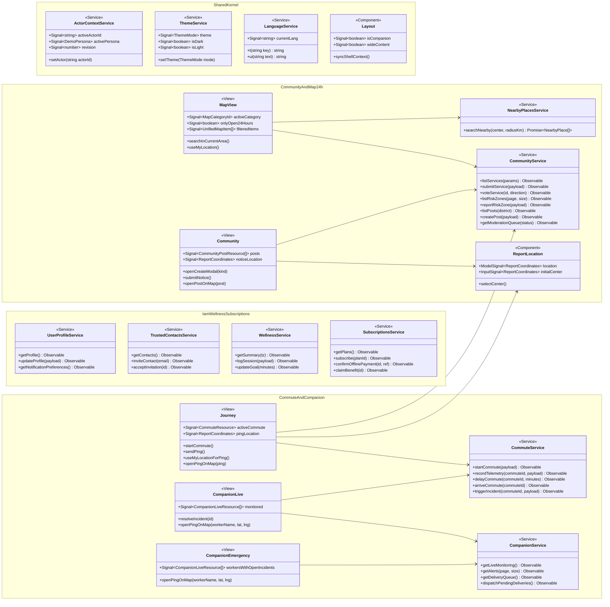

# Noxway Frontend — Diagrama de Clases y Componentes (Angular 21)

> El diagrama completo en formato PlantUML se encuentra en [class-diagram.puml](class-diagram.puml). A continuación se presenta la vista modular en Mermaid compatible con GitHub.

## 1. Arquitectura de Módulos, Servicios y Vistas por Bounded Context

## 2. Capas Internas por Bounded Context

Cada módulo de negocio en `src/app/<contexto>/` mantiene una separación limpia en **3 capas**:

| Capa | Directorio | Responsabilidad |
|---|---|---|
| **Domain** | `domain/model/` | Interfaces de recursos tipados (`*Resource`), payloads de comandos (`*Request`) y reglas puras de cálculo (ej. `service-hours.ts`, `rest-period.ts`, `user-profile.entity.ts`). |
| **Infrastructure** | `infrastructure/` | Servicios HTTP (`HttpClient`) hacia `/api/v1/*`, decodificación de tiles vectoriales PBF (`NearbyPlacesService`), interceptores (`actorContextInterceptor`) y manejo de estado de sesión/tema/idioma. |
| **Presentation** | `presentation/views/` y `presentation/components/` | Componentes standalone Angular 21 basados en Signals (`signal`, `computed`, `effect`, `model`), mapas interactivos Leaflet (`MapView`, `ReportLocation`) y modales nativos `<dialog>`. |
