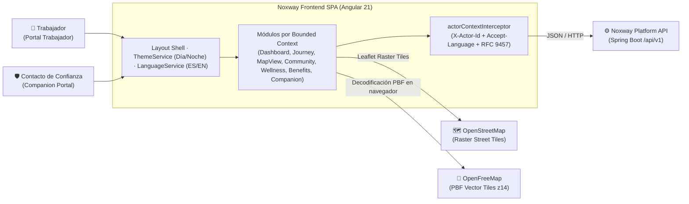
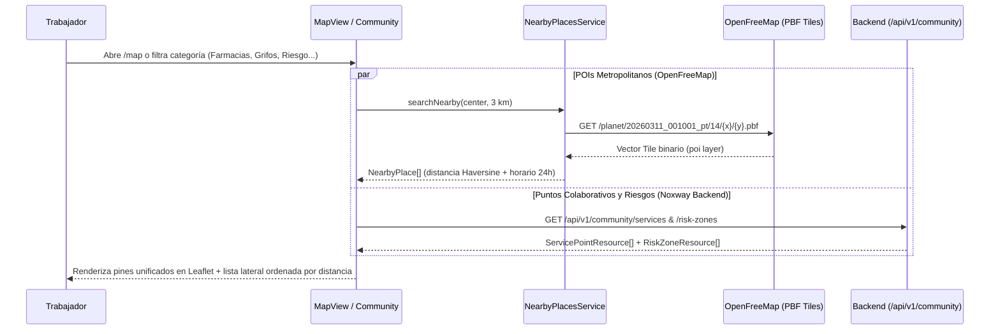

# Noxway Frontend — Arquitectura de Software (Angular 21, OpenStreetMap & Signals)

> La especificación formal en Structurizr C4 DSL se encuentra en [software-architecture.dsl](software-architecture.dsl). Este documento detalla la arquitectura de contenedores, módulos por Bounded Context, flujo de mapas OpenStreetMap + OpenFreeMap y sistema de diseño Día/Noche.

---

## 1. Diagrama de Contexto e Integración del Frontend (C4)

---

## 2. Arquitectura Híbrida de `Mapa 24h` y `Comunidad`

El módulo `community` combina **datos geográficos metropolitanos en vivo** con **datos colaborativos persistidos en el backend**:

---

## 3. Enrutamiento y Carga Diferida (Lazy Loading)

Las rutas pesadas que incorporan cartografía interactiva (`Leaflet`, `pbf`, `@mapbox/vector-tile`) utilizan `loadComponent` en [app.routes.ts](../src/app/app.routes.ts) para mantener el bundle inicial ligero:

| Ruta | Componente | Carga | Portal |
|---|---|---|---|
| `/dashboard` | `Dashboard` | Eager | Trabajador |
| `/journey` | `Journey` (incluye `ReportLocation`) | **Lazy (`chunk-journey`)** | Trabajador |
| `/map` | `MapView` (incluye `Leaflet` + `NearbyPlacesService`) | **Lazy (`chunk-map-view`)** | Trabajador |
| `/community` | `Community` (incluye modal `<dialog>` + `ReportLocation`) | **Lazy (`chunk-community`)** | Trabajador |
| `/wellness` | `Wellness` | Eager | Trabajador |
| `/benefits` | `Benefits` | Eager | Trabajador |
| `/trusted-contacts` | `TrustedContacts` | Eager | Trabajador |
| `/profile` | `Profile` | Eager | Trabajador |
| `/companion/live` | `CompanionLive` | Eager | Companion |
| `/companion/history` | `CompanionHistory` | Eager | Companion |
| `/companion/alerts` | `CompanionAlerts` | Eager | Companion |
| `/companion/emergency` | `CompanionEmergency` | Eager | Companion |
| `/companion/invitations` | `CompanionInvitations` | Eager | Companion |
| `/companion/profile` | `CompanionProfile` | Eager | Companion |

---

## 4. Sistema de Diseño Adaptativo (Modo Día / Modo Noche) e Internacionalización

- **Variables semánticas `--nx-*`**: Definidas en `src/styles.css` bajo `:root` / `[data-theme="dark"]` (Modo Noche) y `[data-theme="light"]` (Modo Día), garantizando contraste accesible en tarjetas, tablas, modales `<dialog>` y controles de mapa.
- **Bilingüe (`ES` / `EN`)**: `LanguageService` sincroniza las etiquetas de interfaz y envía automáticamente la cabecera `Accept-Language` al backend para recibir errores RFC 9457 en el idioma activo.
